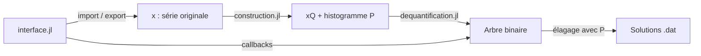

<div align="center">

<pre>
██╗    ██████╗  ███████╗██████╗
██║    ╚════██╗ ██╔════╝╚════██╗
██║     █████╔╝ █████╗  █████╔╝
██║     ██╔═══╝ ██╔══╝ ██╔═══╝
███████╗███████╗██║    ███████╗
</pre>

**Visualise en temps réel la reconstruction d'une série temporelle sous-quantifiée à 1 bit**

</div>

<p align="center">
  
  
  
  
</p>

<p align="center">
  <a href="#démarrage-rapide">Démarrage rapide</a> ·
  <a href="#guide-utilisateur">Guide utilisateur</a> ·
  <a href="#guide-technique">Guide technique</a> ·
  <a href="#documentation">Documentation</a> ·
  <a href="#dépannage">Dépannage</a>
</p>

---

*Version 1.0, 2026 — README généré le 01-03-2026, dernière mise à jour le 20-04-2026.*

L2F2 est une application de **déquantification** de séries temporelles, écrite en Julia. La sous-quantification à 1 bit supprime le bit de poids faible de chaque valeur d'une série `x` et produit `xQ` : chaque valeur devient le nombre pair inférieur ou égal. Cette opération est irréversible, mais pour chaque `xQ[n]`, la valeur d'origine `x[n]` vaut soit `xQ[n]`, soit `xQ[n] + 1`.

L'application exploite l'histogramme `P` des couples de valeurs successives de `x` pour construire un arbre binaire de toutes les séries possibles, puis l'élague en supprimant les branches incompatibles avec `P`. Les séries restantes sont les solutions, et la série originale `x` en fait nécessairement partie.

> C'est une application de **recherche** : elle ne cherche pas uniquement la série originale, mais **toutes** les séries compatibles avec l'histogramme.

## Comment ça marche



### Petit exemple

Soit `x = [3, 4, 7]`. On obtient `xQ = [2, 4, 6]` et `P = {(3,4): 1, (4,7): 1}`.

| Niveau | Valeurs possibles | Couples testés dans P | Résultat |
| ------ | ----------------- | --------------------- | -------- |
| 1      | 2 ou 3            | —                     | deux branches |
| 2      | 4 ou 5            | (2,4) ✗ (2,5) ✗ (3,4) ✓ (3,5) ✗ | la branche `2` est élaguée |
| 3      | 6 ou 7            | (4,6) ✗ (4,7) ✓       | une seule solution : `[3, 4, 7]` |

### Fonctionnement de l'algorithme

- L'arbre est parcouru **en profondeur**.
- Pour chaque nœud, on génère les deux fils possibles (valeur paire et impaire) et on vérifie que le couple formé est encore disponible dans l'histogramme (compteur > 0).
- Si le couple est compatible, le fils copie l'histogramme de son père et décrémente le compteur du couple.
- Sinon, la branche est élaguée : elle est marquée en rouge, et on remonte récursivement tant que le parent n'a plus de fils vivant.
- Quand un nœud atteint le dernier niveau de `xQ`, la branche est extraite et sauvegardée comme solution.

L'histogramme est un dictionnaire qui ne stocke que les couples existants (une matrice serait vide à plus de 95 % sur les grandes séries).

## Plateformes supportées

| OS      | Statut | Notes |
| ------- | :----: | ----- |
| Linux   |   ✅   | Cible principale. |
| Windows |   ✅   | Windows 10/11. Certains antivirus bloquent les DLL de Julia, voir [Dépannage](#dépannage). |
| macOS   |   ⚠️   | Les scripts `.sh` fonctionnent en principe, mais le projet n'a pas été testé dessus. |

### Prérequis

| Élément | Version |
| ------- | ------- |
| Julia | **1.10.11** ([téléchargement](https://julialang.org/downloads/)). Une version plus récente est possible si elle est compatible avec GLMakie. |
| Carte graphique | Compatible OpenGL 3.3+ |
| Mémoire | 4 Go minimum (8 Go recommandés) |

## Fonctionnalités

| Catégorie | Description |
| --------- | ----------- |
| **Préparation des données** | Génère `xQ` et `P` à partir de ta série `x`, et permet de les télécharger |
| **Déquantification** | Construit et élague l'arbre binaire, produit toutes les solutions en fichiers binaires 16 bits |
| **Visualisation** | Arbre animé en temps réel, branches vivantes en bleu, élaguées en rouge, compteur de branches restantes |
| **Contrôle** | Boutons Lancer, Arrêter et Effacer |
| **Import / Export** | Import de `x` ou d'un dossier `xQ` + `P`, export des solutions en archive ZIP |

## Démarrage rapide

### Installation

**Windows** : double-clique sur `install.bat` (installe les dépendances), puis sur `run.bat` (lance l'application). Ou depuis un terminal :

```bat
cd cheminVersLeProjet
install.bat
run.bat
```

**Linux / macOS** :

```bash
cd cheminVersLeProjet
chmod +x install.sh run.sh
./install.sh
./run.sh
```

Les dépendances ne s'installent qu'une fois. L'installation et le premier lancement peuvent être longs (compilation de GLMakie), merci de patienter.

## Guide utilisateur

| Bouton | Action |
| ------ | ------ |
| **Importer x** | Sélectionne une série temporelle au format binaire 16 bits. `xQ` et `P` sont générés automatiquement. |
| **Lancer** | Démarre la construction et l'élagage de l'arbre. |
| **Arrêter** | Stoppe l'animation. Un nouveau clic sur **Lancer** redémarre depuis le début. |
| **Importer xQ et P** | Charge un dossier contenant `xQ` et `P` à la place de `x` (disponible après un premier lancement). |
| **Effacer** | Réinitialise l'interface graphique. |
| **Exporter les solutions** | Télécharge toutes les solutions en archive ZIP. |
| **Télécharger xQ et P** | Récupère dans un dossier le `xQ` et le `P` générés. |

Le fichier importé doit être non vide et contenir plus de deux valeurs, sinon un message d'erreur s'affiche à la place de l'arbre.

### Limites connues

- **Passage à l'échelle** : sur de grandes séries, l'arbre peut mettre très longtemps à se développer (un fichier de 100 valeurs structurées peut ne donner aucune solution en 1h30, alors qu'un fichier aléatoire de même taille se termine en quelques secondes). Le détail est dans le rapport.
- Les boutons d'avance et de recul dans l'animation ne sont pas implémentés.

## Guide technique

```
.
├── LICENSE.txt
├── Manifest.toml
├── Project.toml
├── README.md
├── docs                 # documentation (Documenter.jl)
│   ├── make.jl
│   ├── build/index.html # point d'entrée de la documentation
│   └── src
├── install.bat / install.sh   # installation des dépendances
├── run.bat / run.sh           # lancement de l'application
├── src
│   ├── L2F2_Dequantification_App.jl   # point d'entrée
│   ├── interface.jl                   # interface graphique
│   ├── algorithme
│   │   ├── arbre.jl                   # structures Noeud et Arbre
│   │   ├── construction.jl            # programme auxiliaire : x -> xQ et P
│   │   └── dequantification.jl        # programme principal : construction et élagage
│   └── data                           # xQ et P générés, dossier temp des solutions
└── test
    ├── runtests.jl
    ├── test_arbre.jl
    ├── test_construction.jl
    ├── test_dequantification.jl
    └── data/input                     # jeux de données de test
```

### Modules

| Fichier | Rôle |
| ------- | ---- |
| `arbre.jl` | Structures `Noeud` et `Arbre`, fonctions associées |
| `construction.jl` | Lit `x`, génère `xQ` et `P`, sauvegarde les données |
| `dequantification.jl` | Reçoit `xQ` et `P`, construit et élague l'arbre, génère les solutions |
| `interface.jl` | Interface graphique, appelle les modules précédents via des fonctions de callback |

### Dépendances

Toutes sont installées automatiquement par `install.bat` / `install.sh`.

| Bibliothèque | Utilité |
| ------------ | ------- |
| GLMakie | Bibliothèque graphique principale (OpenGL), boutons et rendu |
| GraphMakie | Affichage et mise à jour de l'arbre |
| Graphs | Structure de graphe (`SimpleDiGraph`) utilisée pour dessiner l'arbre |
| NativeFileDialog | Sélecteur de fichiers natif du système |
| ZipFile | Archive ZIP des solutions |

### Tests

Chaque module a son fichier de test, tous orchestrés par `test/runtests.jl`. Pour les lancer depuis la racine :

```bash
julia --project -e 'using Pkg; Pkg.test()'
```

## Dépannage

| Problème | Solution |
| -------- | -------- |
| Windows bloque `install.bat` ou `run.bat` (Contrôle Intelligent des Applications) | Clic droit sur le fichier, **Propriétés**, onglet **Général**, section **Sécurité**, coche **Débloquer**. |
| `LOAD ERROR: error opening package file <chemin>.dll` | Certains antivirus (notamment McAfee) bloquent les bibliothèques de Julia. Désactive-le le temps de l'installation et de l'utilisation. |
| Le problème persiste | Utilise une machine virtuelle (VirtualBox) ou WSL (Windows Subsystem for Linux). |
| Le premier lancement est très lent | Normal : GLMakie est compilé au premier lancement. |

## Documentation

La documentation complète est dans `docs/build` : ouvre `index.html`. Les documents du projet sont téléchargeables depuis la section « Téléchargement des documents ».

| Document | Description |
| -------- | ----------- |
| Cahier des charges | Besoins et contraintes |
| Cahier de recette | Tests de conformité de l'application |
| Cahier de conception générale et détaillée | Architecture, structures de données, détail de chaque fonction |
| Plan de test | Tests unitaires et d'intégration |
| Rapport | Choix de l'équipe, difficultés rencontrées, bilan et perspectives |

## Auteurs

Développé par Abdallah BENALI, Dina KANGNI, Mohammed ZOUAD et Salim ACHAK, sous la direction de Gaël MAHÉ et de David JANISZEK, dans le cadre de l'UE Projet Professionnel à l'université Paris Cité.

## Licence

Ce projet est distribué sous [licence Apache 2.0](LICENSE.txt). Toute réutilisation ou redistribution commerciale doit mentionner explicitement les auteurs.
