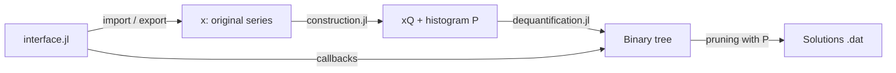

<div align="center">

<pre>
██╗    ██████╗  ███████╗██████╗
██║    ╚════██╗ ██╔════╝╚════██╗
██║     █████╔╝ █████╗  █████╔╝
██║     ██╔═══╝ ██╔══╝ ██╔═══╝
███████╗███████╗██║    ███████╗
</pre>
  **Watch the reconstruction of a 1-bit under-quantized time series in real time**
</div>

<p align="center">
  
  
  
  
</p>

<p align="center">
  <a href="#quick-start">Quick Start</a> ·
  <a href="#user-guide">User Guide</a> ·
  <a href="#technical-guide">Technical Guide</a> ·
  <a href="#documentation">Documentation</a> ·
  <a href="#troubleshooting">Troubleshooting</a>
</p>

---

*Version 1.0, 2026 — README generated on 2026-03-01, last updated on 2026-04-20.*

L2F2 is a **dequantization** application for time series, written in Julia. 1-bit under-quantization removes the least significant bit of every value of a series `x` and produces `xQ`: each value becomes the nearest even number less than or equal to it. This operation is irreversible, but for each `xQ[n]`, the original value `x[n]` is either `xQ[n]` or `xQ[n] + 1`.

The application uses the histogram `P` of successive value pairs of `x` to build a binary tree of all possible series, then prunes it by removing the branches that are incompatible with `P`. The remaining series are the solutions, and the original series `x` is necessarily one of them.

> This is a **research** application: it does not look only for the original series, but for **all** the series compatible with the histogram.

## How It Works



### A small example

Let `x = [3, 4, 7]`. We get `xQ = [2, 4, 6]` and `P = {(3,4): 1, (4,7): 1}`.

| Level | Possible values | Pairs checked in P | Result |
| ----- | --------------- | ------------------ | ------ |
| 1     | 2 or 3          | —                  | two branches |
| 2     | 4 or 5          | (2,4) ✗ (2,5) ✗ (3,4) ✓ (3,5) ✗ | branch `2` is pruned |
| 3     | 6 or 7          | (4,6) ✗ (4,7) ✓    | a single solution: `[3, 4, 7]` |

### How the algorithm works

- The tree is explored **depth-first**.
- For each node, the two possible children are generated (even and odd value), and the resulting pair is checked against the histogram (its counter must still be > 0).
- If the pair is compatible, the child copies its parent's histogram and decrements the counter of that pair.
- Otherwise, the branch is pruned: it is marked in red, and pruning goes back up recursively as long as the parent has no living child left.
- When a node reaches the last level of `xQ`, the branch is extracted and saved as a solution.

The histogram is a dictionary that only stores the pairs that actually exist (a matrix would be more than 95% empty on large series).

## Supported Platforms

| OS      | Status | Notes |
| ------- | :----: | ----- |
| Linux   |   ✅   | Main target. |
| Windows |   ✅   | Windows 10/11. Some antivirus software blocks Julia's DLLs, see [Troubleshooting](#troubleshooting). |
| macOS   |   ⚠️   | The `.sh` scripts should work, but the project has not been tested on it. |

### Requirements

| Item | Version |
| ---- | ------- |
| Julia | **1.10.11** ([download](https://julialang.org/downloads/)). A more recent version may work if it is compatible with GLMakie. |
| Graphics card | OpenGL 3.3+ compatible |
| Memory | 4 GB minimum (8 GB recommended) |

## Features

| Category | Description |
| -------- | ----------- |
| **Data preparation** | Generates `xQ` and `P` from your series `x`, and lets you download them |
| **Dequantization** | Builds and prunes the binary tree, outputs all solutions as 16-bit binary files |
| **Visualization** | Tree animated in real time, living branches in blue, pruned ones in red, remaining branch counter |
| **Control** | Launch, Stop and Clear buttons |
| **Import / Export** | Import `x` or a folder containing `xQ` + `P`, export solutions as a ZIP archive |

## Quick Start

### Installation

**Windows**: double-click `install.bat` (installs the dependencies), then `run.bat` (starts the application). Or from a terminal:

```bat
cd pathToTheProject
install.bat
run.bat
```

**Linux / macOS**:

```bash
cd pathToTheProject
chmod +x install.sh run.sh
./install.sh
./run.sh
```

Dependencies only need to be installed once. Installation and the first launch can take a while (GLMakie compilation), so please be patient.

## User Guide

| Button | Action |
| ------ | ------ |
| **Importer x** | Select a time series in 16-bit binary format. `xQ` and `P` are generated automatically. |
| **Lancer** | Starts building and pruning the tree. |
| **Arrêter** | Stops the animation. Clicking **Lancer** again restarts from the beginning. |
| **Importer xQ et P** | Loads a folder containing `xQ` and `P` instead of `x` (available after a first launch). |
| **Effacer** | Resets the graphical interface. |
| **Exporter les solutions** | Downloads all the solutions as a ZIP archive. |
| **Telecharger xQ et P** | Saves the generated `xQ` and `P` to a folder. |

*(The button labels are in French in the application.)*

The imported file must not be empty and must contain more than two values, otherwise an error message is displayed in place of the tree.

### Known limitations

- **Scalability**: on large series, the tree can take a very long time to grow (a 100-value structured file may give no solution after 1h30, while a random file of the same size finishes in a few seconds). Details are in the report.
- Step forward / step backward buttons in the animation are not implemented.

## Technical Guide

```
.
├── LICENSE.txt
├── Manifest.toml
├── Project.toml
├── README.md
├── docs                 # documentation (Documenter.jl)
│   ├── make.jl
│   ├── build/index.html # documentation entry point
│   └── src
├── install.bat / install.sh   # dependency installation
├── run.bat / run.sh           # application launch
├── src
│   ├── L2F2_Dequantification_App.jl   # entry point
│   ├── interface.jl                   # graphical interface
│   ├── algorithme
│   │   ├── arbre.jl                   # Noeud and Arbre structures
│   │   ├── construction.jl            # auxiliary program: x -> xQ and P
│   │   └── dequantification.jl        # main program: tree building and pruning
│   └── data                           # generated xQ and P, temp folder for solutions
└── test
    ├── runtests.jl
    ├── test_arbre.jl
    ├── test_construction.jl
    ├── test_dequantification.jl
    └── data/input                     # test datasets
```

### Modules

| File | Role |
| ---- | ---- |
| `arbre.jl` | `Noeud` and `Arbre` structures, and related functions |
| `construction.jl` | Reads `x`, generates `xQ` and `P`, saves the data |
| `dequantification.jl` | Takes `xQ` and `P`, builds and prunes the tree, generates the solutions |
| `interface.jl` | Graphical interface, calls the previous modules through callback functions |

### Dependencies

All of them are installed automatically by `install.bat` / `install.sh`.

| Library | Purpose |
| ------- | ------- |
| GLMakie | Main graphics library (OpenGL), buttons and rendering |
| GraphMakie | Display and update of the tree |
| Graphs | Graph structure (`SimpleDiGraph`) used to draw the tree |
| NativeFileDialog | Native file picker of the operating system |
| ZipFile | ZIP archive of the solutions |

### Tests

Each module has its own test file, all orchestrated by `test/runtests.jl`. To run them from the project root:

```bash
julia --project -e 'using Pkg; Pkg.test()'
```

## Troubleshooting

| Problem | Solution |
| ------- | -------- |
| Windows blocks `install.bat` or `run.bat` (Smart App Control) | Right-click the file, **Properties**, **General** tab, **Security** section, check **Unblock**. |
| `LOAD ERROR: error opening package file <path>.dll` | Some antivirus software (notably McAfee) blocks Julia's libraries. Disable it during installation and use. |
| The problem persists | Use a virtual machine (VirtualBox) or WSL (Windows Subsystem for Linux). |
| The first launch is very slow | Expected: GLMakie is compiled on the first launch. |

## Documentation

The full documentation is in `docs/build`: open `index.html`. The project documents can be downloaded from the "Téléchargement des documents" section.

| Document | Description |
| -------- | ----------- |
| Specifications (cahier des charges) | Needs and constraints |
| Acceptance test book (cahier de recette) | Conformity tests of the application |
| General and detailed design document | Architecture, data structures, detail of every function |
| Test plan | Unit and integration tests |
| Report | Team choices, difficulties encountered, review and perspectives |

*(Project documents are written in French.)*

## Authors

Developed by Abdallah BENALI, Dina KANGNI, Mohammed ZOUAD and Salim ACHAK, under the supervision of Gaël MAHÉ and David JANISZEK, as part of the Professional Project course (UE Projet Professionnel) at Université Paris Cité.

## License

This project is distributed under the [Apache 2.0 license](LICENSE.txt). Any reuse or commercial redistribution must explicitly credit the authors.
